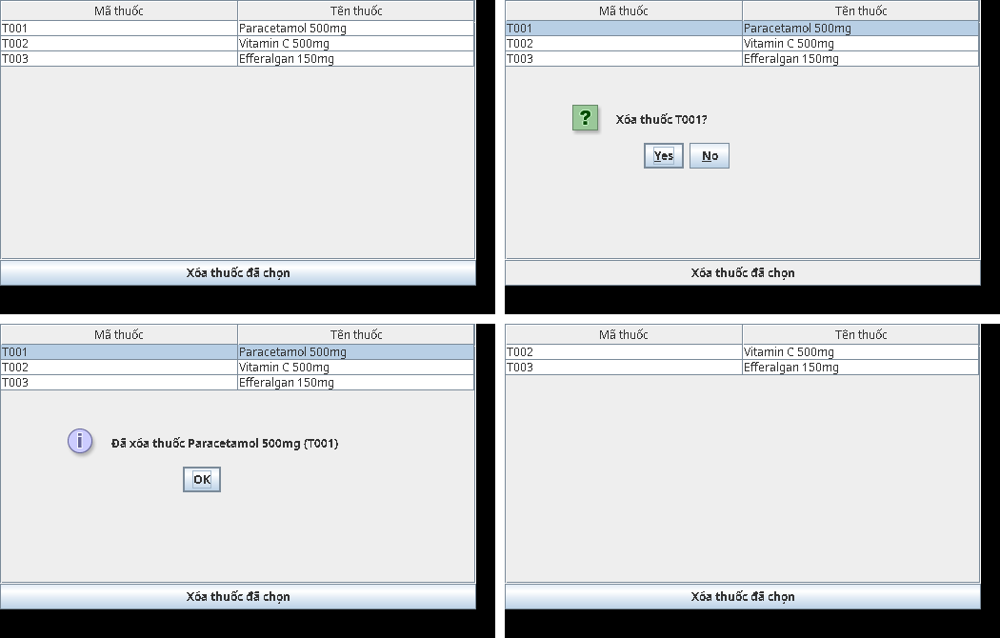

# 08 – Tự viết lại bài từ con số 0

Đọc code người khác thì 10 phút là "hiểu", nhưng gấp tài liệu lại là quên. Cách học chắc nhất là **tự gõ lại một bản nhỏ**, mỗi bước chạy được ngay, rồi mới so với bài thật. Học theo file này xong, bạn sẽ hiểu bài đủ để dạy lại cho người khác.

**Mọi đoạn code dưới đây đã được biên dịch và chạy thử thật.** Kết quả ghi dưới mỗi bước là kết quả chạy thật.

| Bước | Viết gì | Dòng code | Thời gian | Học được |
|---|---|---|---|---|
| 0 | Tạo project tập | 0 | 10 phút | Chỗ để gõ, không đụng bài nộp |
| 1 | Server nhại lời + Client gửi một câu | ~40 | 30 phút | UDP gửi/nhận thế nào |
| 2 | Client chờ tối đa 5 giây | +10 | 15 phút | Vì sao UDP cần timeout |
| 3 | Server có danh sách thuốc, lệnh `LIST_MED`, `DEL_MED` | ~50 | 45 phút | "Giao thức" là gì: hai bên thống nhất câu chữ |
| 4 | Thêm công dụng + quy tắc "còn thuốc dùng thì không xóa" | +40 | 30 phút | Quy tắc nghiệp vụ nằm ở Server |
| 5 | Giao diện mini: bảng + nút Xóa | ~90 | 1 giờ | Swing, vì sao phải gửi UDP ở luồng nền |
| 6 | Đặt bản mini cạnh bài thật, tìm chỗ tương ứng | 0 | 45 phút | Bài thật = bản mini + tách file + làm đẹp |

Tổng khoảng 4 giờ. **Gõ tay, đừng copy-paste.** Gõ sai, đọc lỗi rồi tự sửa chính là phần học.

---

## Bước 0 – Tạo project tập

1. IntelliJ: **File → New → Project** → chọn **Java**, Build system **IntelliJ**, JDK **17 trở lên**, đặt tên `tap-udp`, để ở ngoài thư mục `Mon2` (ví dụ `~/tap-udp`).
2. Chuột phải `src` → **New → Package** → `tap.b1`. Các bước sau làm thêm package `tap.b3`, `tap.b4`, `tap.b6`.

> **Quan trọng:** bài thật `MedicineServer` và bản tập dùng **chung cổng 9876**. Hai chương trình không thể cùng giữ một cổng: chạy cái thứ hai sẽ báo `java.net.BindException: Address already in use`. **Tắt Server cũ (nút ■ đỏ) trước khi chạy Server mới.** Lỗi này mình đã gặp thật khi chạy thử tài liệu.

---

## Bước 1 – Server nhại lời, Client gửi một câu

**Ý tưởng:** Server mở một "hòm thư" ở cổng 9876 rồi đứng chờ. Client gửi một câu chữ vào hòm đó. Server đọc câu đó rồi gửi lại "Server đã nhận: …" về **đúng địa chỉ người gửi**.

Ba thứ cần nhớ:
- `DatagramSocket` = cái hòm thư. Server ghi rõ số cổng (`new DatagramSocket(9876)`), Client không ghi (máy tự cấp một cổng trống).
- `DatagramPacket` = một lá thư: gồm mảng byte nội dung và địa chỉ (IP + cổng).
- Mạng chỉ chở **byte**, nên chữ → byte bằng `getBytes(UTF_8)`, byte → chữ bằng `new String(..., UTF_8)`. Luôn ghi rõ UTF-8 để tiếng Việt không vỡ trên Windows.

`tap/b1/EchoServer.java`
```java
package tap.b1;

import java.net.DatagramPacket;
import java.net.DatagramSocket;
import java.nio.charset.StandardCharsets;

public class EchoServer {
    public static void main(String[] args) throws Exception {
        DatagramSocket socket = new DatagramSocket(9876);          // mở "hòm thư" ở cổng 9876
        System.out.println("Server đang chờ ở cổng 9876");
        byte[] buffer = new byte[8192];
        while (true) {
            DatagramPacket packet = new DatagramPacket(buffer, buffer.length);
            socket.receive(packet);                                 // đứng chờ tới khi có gói tin
            String text = new String(packet.getData(), 0, packet.getLength(), StandardCharsets.UTF_8);
            System.out.println("Nhận từ " + packet.getSocketAddress() + ": " + text);

            byte[] reply = ("Server đã nhận: " + text).getBytes(StandardCharsets.UTF_8);
            socket.send(new DatagramPacket(reply, reply.length, packet.getSocketAddress()));  // trả về đúng người gửi
        }
    }
}
```

`tap/b1/EchoClient.java`
```java
package tap.b1;

import java.net.DatagramPacket;
import java.net.DatagramSocket;
import java.net.InetSocketAddress;
import java.nio.charset.StandardCharsets;
import java.util.Scanner;

public class EchoClient {
    public static void main(String[] args) throws Exception {
        Scanner keyboard = new Scanner(System.in, StandardCharsets.UTF_8);
        InetSocketAddress server = new InetSocketAddress("127.0.0.1", 9876);
        DatagramSocket socket = new DatagramSocket();               // không ghi cổng: máy tự cấp một cổng trống
        System.out.print("Gõ một câu: ");
        byte[] out = keyboard.nextLine().getBytes(StandardCharsets.UTF_8);
        socket.send(new DatagramPacket(out, out.length, server));

        byte[] buffer = new byte[8192];
        DatagramPacket packet = new DatagramPacket(buffer, buffer.length);
        socket.receive(packet);
        System.out.println(new String(packet.getData(), 0, packet.getLength(), StandardCharsets.UTF_8));
        socket.close();
    }
}
```

**Chạy:** Run `EchoServer` trước, rồi Run `EchoClient`, gõ `Xin chào Server`, Enter.

Kết quả chạy thật:
```
[Client] Gõ một câu: Xin chào Server
[Client] Server đã nhận: Xin chào Server
[Server] Server đang chờ ở cổng 9876
[Server] Nhận từ /127.0.0.1:39337: Xin chào Server
```
Số `39337` là cổng máy tự cấp cho Client, mỗi lần chạy một số khác. Server dùng `packet.getSocketAddress()` để biết trả lời về đâu.

**Tự thử:** tắt Server rồi chạy Client. Client **đứng im mãi mãi**, vì `receive` chờ một lá thư không bao giờ tới. Bước 2 sửa đúng lỗi này.

---

## Bước 2 – Client chỉ chờ tối đa 5 giây

UDP giống **bỏ thư không có báo nhận**: gửi đi rồi thì không biết thư có tới hay không. Vì vậy Client tự đặt giới hạn: chờ 5 giây, không thấy trả lời thì báo lỗi.

Chỉ cần một dòng `socket.setSoTimeout(5000)`. Quá 5 giây, `receive` ném ra `SocketTimeoutException` và mình bắt lỗi đó để in thông báo dễ hiểu.

Client dưới đây dùng luôn cho bước 3 và 4. Nó lặp liên tục: bạn gõ `DEL_MED T001`, nó đổi dấu cách đầu tiên thành ký tự TAB rồi gửi đi.

`tap/b3/MiniClient.java`
```java
package tap.b3;

import java.net.DatagramPacket;
import java.net.DatagramSocket;
import java.net.InetSocketAddress;
import java.net.SocketTimeoutException;
import java.nio.charset.StandardCharsets;
import java.util.Scanner;

public class MiniClient {
    public static void main(String[] args) throws Exception {
        Scanner keyboard = new Scanner(System.in, StandardCharsets.UTF_8);
        while (true) {
            System.out.print("> ");
            if (!keyboard.hasNextLine()) {
                return;
            }
            String line = keyboard.nextLine().trim().replaceFirst(" ", "\t");   // "DEL_MED T001" -> "DEL_MED<TAB>T001"
            try {
                System.out.println(send(line));
            } catch (SocketTimeoutException e) {
                System.out.println("Quá 5 giây không thấy Server trả lời. Server đã chạy chưa?");
            }
        }
    }

    static String send(String request) throws Exception {
        try (DatagramSocket socket = new DatagramSocket()) {
            socket.setSoTimeout(5000);                              // chờ tối đa 5 giây, quá thì ném SocketTimeoutException
            byte[] out = request.getBytes(StandardCharsets.UTF_8);
            socket.send(new DatagramPacket(out, out.length, new InetSocketAddress("127.0.0.1", 9876)));
            byte[] buffer = new byte[8192];
            DatagramPacket packet = new DatagramPacket(buffer, buffer.length);
            socket.receive(packet);
            return new String(packet.getData(), 0, packet.getLength(), StandardCharsets.UTF_8);
        }
    }
}
```

Kết quả chạy thật **khi chưa bật Server**, gõ `LIST_MED`:
```
> Quá 5 giây không thấy Server trả lời. Server đã chạy chưa?
```

`try (DatagramSocket socket = ...)` là cú pháp "dùng xong tự đóng". Kotlin có cái tương tự là `.use { }`.

---

## Bước 3 – Server có danh sách thuốc: giao thức tự đặt

Giờ hai bên phải **thống nhất câu chữ**. Thống nhất này gọi là **giao thức** (protocol). Bài này tự đặt như sau:

| Client gửi | Server trả |
|---|---|
| `LIST_MED` | `OK<TAB>T001\|Paracetamol 500mg<xuống dòng>T002\|...` |
| `DEL_MED<TAB>T001` | `OK<TAB>Đã xóa thuốc ...` hoặc `ERR<TAB>lý do` |
| lệnh lạ | `ERR<TAB>Lệnh không hợp lệ: ...` |

Server cất dữ liệu trong `Map` (giống `mutableMapOf` của Kotlin), tức là chỉ nằm trong bộ nhớ: tắt Server là mất, bật lại thì có dữ liệu mẫu như cũ. Hàm `handle` nhận câu chữ của Client và trả về câu chữ để gửi lại. Đây là trái tim của Server.

`tap/b3/MiniServer.java`
```java
package tap.b3;

import java.net.DatagramPacket;
import java.net.DatagramSocket;
import java.nio.charset.StandardCharsets;
import java.util.LinkedHashMap;
import java.util.Map;

public class MiniServer {
    static Map<String, String> medicines = new LinkedHashMap<>();   // mã thuốc -> tên thuốc

    public static void main(String[] args) throws Exception {
        medicines.put("T001", "Paracetamol 500mg");
        medicines.put("T002", "Vitamin C 500mg");
        medicines.put("T003", "Povidone iodine 10%");

        DatagramSocket socket = new DatagramSocket(9876);
        System.out.println("MiniServer đang chờ ở cổng 9876");
        byte[] buffer = new byte[8192];
        while (true) {
            DatagramPacket packet = new DatagramPacket(buffer, buffer.length);
            socket.receive(packet);
            String request = new String(packet.getData(), 0, packet.getLength(), StandardCharsets.UTF_8);
            String response = handle(request);
            System.out.println(request.replace("\t", " ") + "  ->  " + response.replace("\n", " / "));
            byte[] out = response.getBytes(StandardCharsets.UTF_8);
            socket.send(new DatagramPacket(out, out.length, packet.getSocketAddress()));
        }
    }

    static String handle(String request) {
        String[] parts = request.split("\t");
        String command = parts[0];
        String id = parts.length > 1 ? parts[1].toUpperCase() : "";
        switch (command) {
            case "LIST_MED":
                StringBuilder rows = new StringBuilder();
                for (Map.Entry<String, String> m : medicines.entrySet()) {
                    rows.append(m.getKey()).append("|").append(m.getValue()).append("\n");
                }
                return "OK\t" + rows.toString().trim();
            case "DEL_MED":
                String removed = medicines.remove(id);
                if (removed == null) {
                    return "ERR\tKhông tìm thấy thuốc mã " + id;
                }
                return "OK\tĐã xóa thuốc " + removed + " (" + id + ")";
            default:
                return "ERR\tLệnh không hợp lệ: " + command;
        }
    }
}
```

**Chạy:** Run `tap.b3.MiniServer`, rồi Run `MiniClient` và gõ lần lượt từng lệnh. Kết quả chạy thật:
```
> LIST_MED
OK	T001|Paracetamol 500mg
T002|Vitamin C 500mg
T003|Povidone iodine 10%
> DEL_MED t001
OK	Đã xóa thuốc Paracetamol 500mg (T001)
> DEL_MED T001
ERR	Không tìm thấy thuốc mã T001
> LIST_MED
OK	T002|Vitamin C 500mg
T003|Povidone iodine 10%
> ABC
ERR	Lệnh không hợp lệ: ABC
```
Gõ `t001` chữ thường vẫn xóa được, vì Server có `toUpperCase()`. Xóa lần hai thì báo lỗi, vì thuốc đã mất khỏi `Map`.

---

## Bước 4 – Thêm công dụng và quy tắc "còn thuốc dùng thì không xóa"

Mỗi thuốc thuộc một công dụng (Paracetamol → Hạ sốt). Nếu xóa công dụng "Hạ sốt" trong khi Paracetamol vẫn trỏ tới nó, dữ liệu sẽ bị "mồ côi". Vì vậy Server **từ chối**, kèm danh sách thuốc đang dùng.

Quy tắc này đặt ở **Server**, không đặt ở Client. Lý do: có thể có nhiều Client, và chỉ Server biết dữ liệu mới nhất. Đây là câu thầy rất hay hỏi.

So với bước 3, có ba thay đổi: thêm 2 `Map` (`usages`, `medicineUsage`), thêm lệnh `LIST_USE` và `DEL_USE`, và hàm `deleteUsage` kiểm tra quy tắc.

`tap/b4/MiniServer.java`
```java
package tap.b4;

import java.net.DatagramPacket;
import java.net.DatagramSocket;
import java.nio.charset.StandardCharsets;
import java.util.ArrayList;
import java.util.LinkedHashMap;
import java.util.List;
import java.util.Map;

public class MiniServer {
    static Map<String, String> medicines = new LinkedHashMap<>();   // mã thuốc -> tên thuốc
    static Map<String, String> medicineUsage = new LinkedHashMap<>(); // mã thuốc -> mã công dụng
    static Map<String, String> usages = new LinkedHashMap<>();      // mã công dụng -> tên công dụng

    public static void main(String[] args) throws Exception {
        usages.put("CD01", "Giảm đau");
        usages.put("CD02", "Hạ sốt");
        usages.put("CD03", "Bổ sung vitamin");
        addMedicine("T001", "Paracetamol 500mg", "CD02");
        addMedicine("T002", "Vitamin C 500mg", "CD03");
        addMedicine("T003", "Efferalgan 150mg", "CD02");

        DatagramSocket socket = new DatagramSocket(9876);
        System.out.println("MiniServer đang chờ ở cổng 9876");
        byte[] buffer = new byte[8192];
        while (true) {
            DatagramPacket packet = new DatagramPacket(buffer, buffer.length);
            socket.receive(packet);
            String request = new String(packet.getData(), 0, packet.getLength(), StandardCharsets.UTF_8);
            String response = handle(request);
            System.out.println(request.replace("\t", " ") + "  ->  " + response.replace("\n", " / "));
            byte[] out = response.getBytes(StandardCharsets.UTF_8);
            socket.send(new DatagramPacket(out, out.length, packet.getSocketAddress()));
        }
    }

    static void addMedicine(String id, String name, String usageId) {
        medicines.put(id, name);
        medicineUsage.put(id, usageId);
    }

    static String handle(String request) {
        String[] parts = request.split("\t");
        String command = parts[0];
        String id = parts.length > 1 ? parts[1].toUpperCase() : "";
        switch (command) {
            case "LIST_MED":
                return "OK\t" + rows(medicines);
            case "LIST_USE":
                return "OK\t" + rows(usages);
            case "DEL_MED":
                String removed = medicines.remove(id);
                if (removed == null) {
                    return "ERR\tKhông tìm thấy thuốc mã " + id;
                }
                medicineUsage.remove(id);
                return "OK\tĐã xóa thuốc " + removed + " (" + id + ")";
            case "DEL_USE":
                return deleteUsage(id);
            default:
                return "ERR\tLệnh không hợp lệ: " + command;
        }
    }

    static String deleteUsage(String id) {
        if (!usages.containsKey(id)) {
            return "ERR\tKhông tìm thấy công dụng mã " + id;
        }
        List<String> users = new ArrayList<>();
        for (Map.Entry<String, String> m : medicineUsage.entrySet()) {
            if (m.getValue().equals(id)) {
                users.add(m.getKey());
            }
        }
        if (!users.isEmpty()) {
            return "ERR\tKhông thể xóa: công dụng " + id + " đang được thuốc " + users + " sử dụng";
        }
        return "OK\tĐã xóa công dụng " + usages.remove(id) + " (" + id + ")";
    }

    static String rows(Map<String, String> map) {
        StringBuilder rows = new StringBuilder();
        for (Map.Entry<String, String> e : map.entrySet()) {
            rows.append(e.getKey()).append("|").append(e.getValue()).append("\n");
        }
        return rows.toString().trim();
    }
}
```

**Chạy:** tắt Server bước 3, Run `tap.b4.MiniServer`, dùng lại `MiniClient`. Kết quả chạy thật:
```
> LIST_USE
OK	CD01|Giảm đau
CD02|Hạ sốt
CD03|Bổ sung vitamin
> DEL_USE CD02
ERR	Không thể xóa: công dụng CD02 đang được thuốc [T001, T003] sử dụng
> DEL_MED T001
OK	Đã xóa thuốc Paracetamol 500mg (T001)
> DEL_MED T003
OK	Đã xóa thuốc Efferalgan 150mg (T003)
> DEL_USE cd02
OK	Đã xóa công dụng Hạ sốt (CD02)
> DEL_USE CD09
ERR	Không tìm thấy công dụng mã CD09
```

Đến đây bạn đã viết xong **toàn bộ phần mạng và nghiệp vụ** của bài. Phần còn lại chỉ là giao diện.

---

## Bước 5 – Giao diện mini: bảng thuốc + nút Xóa

Ba khái niệm Swing cần biết:
- `JFrame` = cửa sổ. `JTable` = bảng; dữ liệu của bảng nằm trong `DefaultTableModel` (thêm dòng bằng `addRow`, xóa hết bằng `setRowCount(0)`).
- `JOptionPane` = hộp thoại có sẵn: hỏi Có/Không, báo kết quả.
- **Luồng giao diện (EDT)**: Swing vẽ và nhận chuột bằng **một luồng duy nhất**. Nếu gửi UDP ngay trên luồng này, trong lúc chờ Server (tối đa 5 giây) cửa sổ sẽ **đơ cứng**. Vì vậy gửi UDP trong `SwingWorker`: `doInBackground` chạy ở luồng nền, `done` quay về luồng giao diện để cập nhật bảng. Nó giống `withContext(Dispatchers.IO)` trong Kotlin.

`tap/b6/MiniGui.java`
```java
package tap.b6;

import java.awt.BorderLayout;
import java.net.DatagramPacket;
import java.net.DatagramSocket;
import java.net.InetSocketAddress;
import java.nio.charset.StandardCharsets;
import java.util.function.Consumer;
import javax.swing.JButton;
import javax.swing.JFrame;
import javax.swing.JOptionPane;
import javax.swing.JScrollPane;
import javax.swing.JTable;
import javax.swing.SwingUtilities;
import javax.swing.SwingWorker;
import javax.swing.table.DefaultTableModel;

public class MiniGui extends JFrame {
    private final DefaultTableModel model = new DefaultTableModel(new String[] {"Mã thuốc", "Tên thuốc"}, 0);
    private final JTable table = new JTable(model);

    public MiniGui() {
        super("Mini – Xóa thuốc qua UDP");
        setDefaultCloseOperation(EXIT_ON_CLOSE);
        setSize(500, 300);
        JButton deleteButton = new JButton("Xóa thuốc đã chọn");
        deleteButton.addActionListener(e -> deleteSelected());
        add(new JScrollPane(table), BorderLayout.CENTER);
        add(deleteButton, BorderLayout.SOUTH);
        reload();
    }

    private void reload() {
        call("LIST_MED", response -> {
            model.setRowCount(0);                                   // xóa hết dòng cũ
            String body = response.substring(3);                    // bỏ "OK\t"
            for (String row : body.split("\n")) {
                if (!row.isEmpty()) {
                    model.addRow(row.split("\\|"));                 // "T001|Paracetamol" -> 2 ô
                }
            }
        });
    }

    private void deleteSelected() {
        int row = table.getSelectedRow();
        if (row < 0) {
            JOptionPane.showMessageDialog(this, "Hãy chọn một dòng trước");
            return;
        }
        String id = (String) model.getValueAt(row, 0);
        int answer = JOptionPane.showConfirmDialog(this, "Xóa thuốc " + id + "?", "Xác nhận", JOptionPane.YES_NO_OPTION);
        if (answer != JOptionPane.YES_OPTION) {
            return;
        }
        call("DEL_MED\t" + id, response -> {
            JOptionPane.showMessageDialog(this, response.substring(response.indexOf('\t') + 1));
            reload();
        });
    }

    // Gửi UDP ở luồng nền để cửa sổ không bị đơ trong lúc chờ Server (tối đa 5 giây).
    private void call(String request, Consumer<String> onDone) {
        new SwingWorker<String, Void>() {
            @Override
            protected String doInBackground() throws Exception {
                return send(request);
            }

            @Override
            protected void done() {
                try {
                    onDone.accept(get());
                } catch (Exception e) {
                    JOptionPane.showMessageDialog(MiniGui.this, "Không kết nối được Server: " + e.getCause());
                }
            }
        }.execute();
    }

    private static String send(String request) throws Exception {
        try (DatagramSocket socket = new DatagramSocket()) {
            socket.setSoTimeout(5000);
            byte[] out = request.getBytes(StandardCharsets.UTF_8);
            socket.send(new DatagramPacket(out, out.length, new InetSocketAddress("127.0.0.1", 9876)));
            byte[] buffer = new byte[8192];
            DatagramPacket packet = new DatagramPacket(buffer, buffer.length);
            socket.receive(packet);
            return new String(packet.getData(), 0, packet.getLength(), StandardCharsets.UTF_8);
        }
    }

    public static void main(String[] args) {
        SwingUtilities.invokeLater(() -> new MiniGui().setVisible(true));
    }
}
```

**Chạy:** Run `tap.b4.MiniServer`, rồi Run `MiniGui`. Chọn dòng T001, bấm "Xóa thuốc đã chọn", bấm Yes. Kết quả chạy thật, theo thứ tự trái → phải, trên → dưới:



**Tự thử:** tắt Server rồi bấm Xóa. Sau 5 giây sẽ hiện "Không kết nối được Server", và trong lúc chờ cửa sổ vẫn kéo đi được. Đó là nhờ `SwingWorker`.

**Bài tập tự làm** (không có đáp án sẵn, làm xong thì so với bài thật):
1. Thêm nút "Tải lại" gọi `reload()`.
2. Thêm cột "Công dụng" cho bảng thuốc (Server phải gửi thêm trường đó).
3. Làm thêm một cửa sổ tương tự cho công dụng, dùng lệnh `LIST_USE` và `DEL_USE`.

---

## Bước 6 – Đặt bản mini cạnh bài thật

Bài thật **không làm gì khác về bản chất**. Nó chỉ tách code ra nhiều file cho gọn và làm giao diện đẹp hơn. Mở song song hai bản và tìm chỗ tương ứng:

| Bản mini của bạn | Bài thật (`source/src/main/java/`) | Bài thật làm thêm gì |
|---|---|---|
| Chuỗi `"LIST_MED"`, `9876`, `5000` gõ thẳng trong code | `bt3/common/Protocol.java` | Gom tất cả hằng số về một chỗ, Client và Server dùng chung, đổi một nơi là đủ |
| Chuỗi `"OK\t..."` tự ghép | `bt3/common/Response.java` | Một kiểu dữ liệu `Response(ok, body)` có sẵn hàm `format()` và `parse()` |
| `Map<String,String>` mã → tên | `bt3/common/Medicine.java`, `Usage.java` | `record` (giống `data class` Kotlin) đủ trường: giá, dạng bào chế, mô tả |
| `handle()` + `deleteUsage()` | `bt3/server/MedicineServer.java` `handle`, `deleteMedicine`, `deleteUsage` | `synchronized`, `switch ->`, thông báo lỗi chi tiết hơn |
| `send()` trong Client | `bt3/client/UdpClient.java` | Tách riêng để mọi màn hình dùng chung |
| `MiniGui` | `MedicineClient.java` + `DeletePanel.java` | 3 tab; một `DeletePanel` dùng lại cho cả thuốc lẫn công dụng |
| `JOptionPane` báo kết quả | `ResultLogPanel.java` | Tab "Kết quả xóa" ghi nhật ký mọi lần xóa, tô xanh/đỏ |
| (chưa có) | `Ui.java` | Màu, font, kích thước gom một chỗ |

**Cách kiểm tra mình đã hiểu:** đóng tài liệu, mở `MedicineServer.java` và chỉ ra 4 chỗ: mở cổng, đứng chờ, xử lý lệnh, gửi trả. Sau đó mở `DeletePanel.java` và chỉ ra chỗ hỏi xác nhận. Làm được thì bạn đủ sức dạy lại.

---

## Khi dạy lại cho bạn

Dạy đúng thứ tự các bước ở trên, mỗi bước **cho bạn chạy tận mắt** rồi mới giải thích:
1. Bước 1: "Hai chương trình nói chuyện với nhau bằng thư". Cho bạn tắt Server để thấy Client đứng im.
2. Bước 2: "Vì UDP không có báo nhận nên phải tự đặt giờ chờ".
3. Bước 3–4: "Hai bên thống nhất câu chữ. Quy tắc xóa nằm ở Server". Cho bạn gõ `DEL_USE CD02` để thấy bị từ chối.
4. Bước 5–6: "Giao diện chỉ là cái vỏ gửi đúng những câu chữ đó".

Sau đó chuyển sang [05 – Sửa code khi thi](05_sua_code_khi_thi.md) để luyện thêm chức năng mới.
