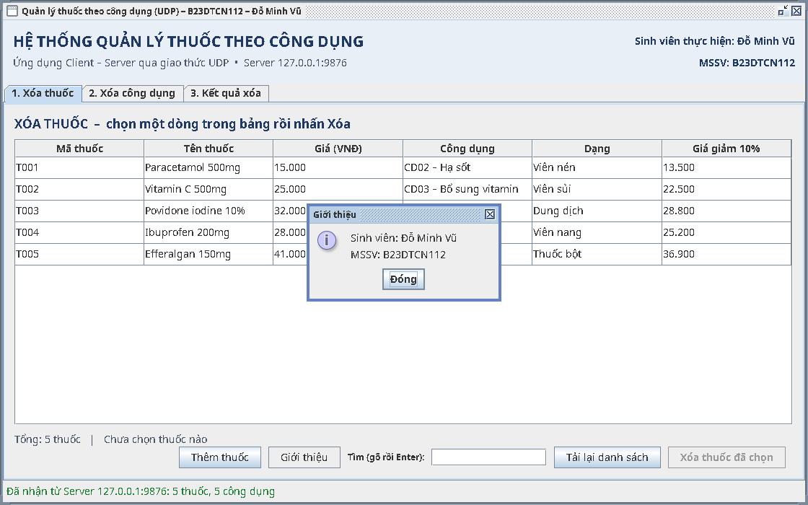
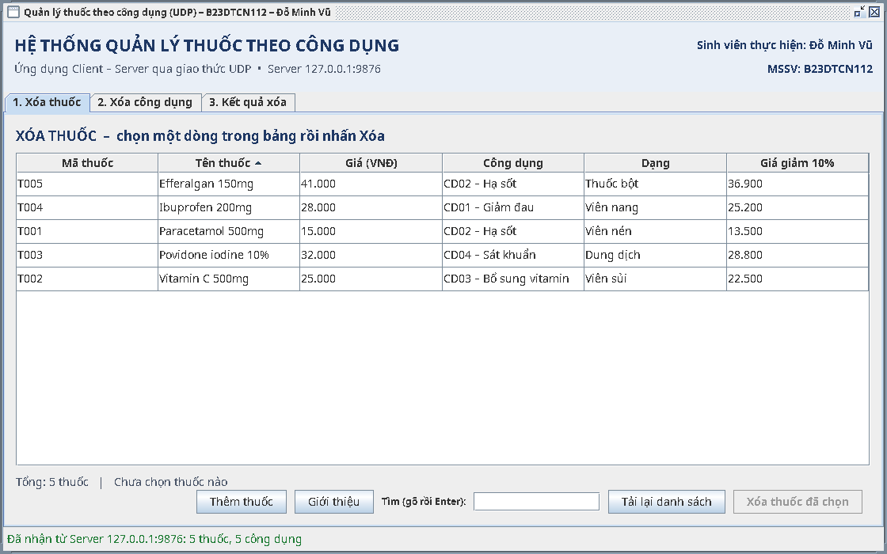
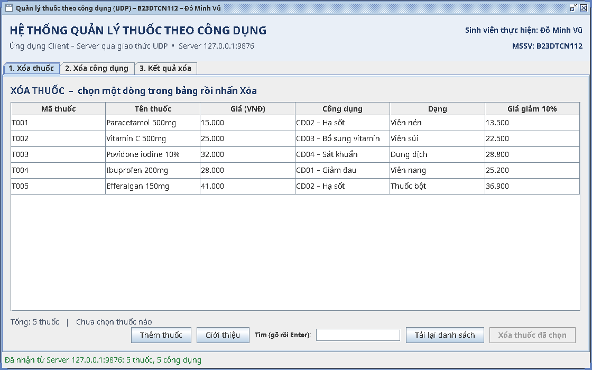
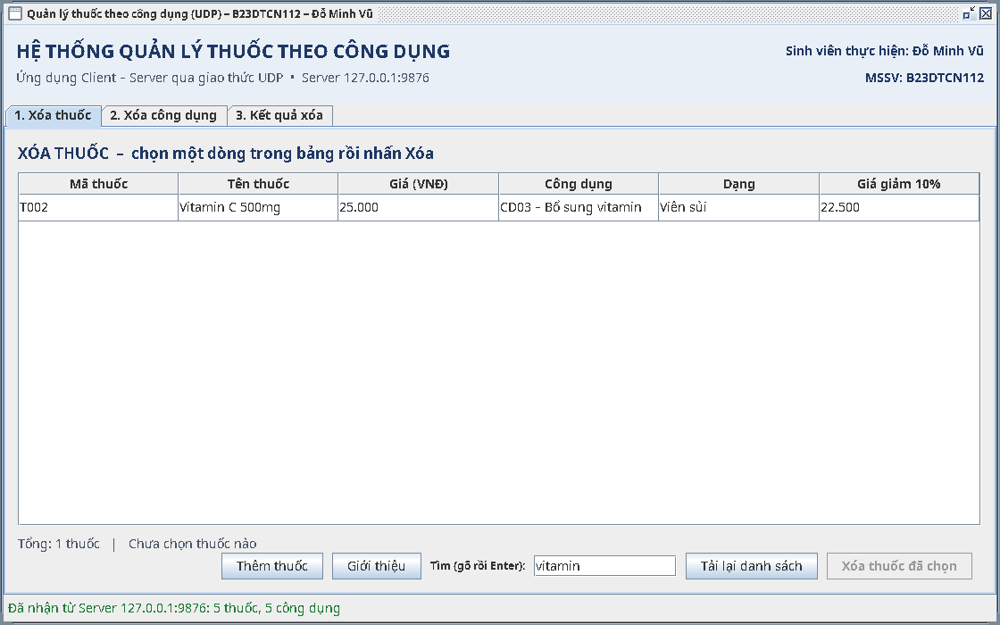
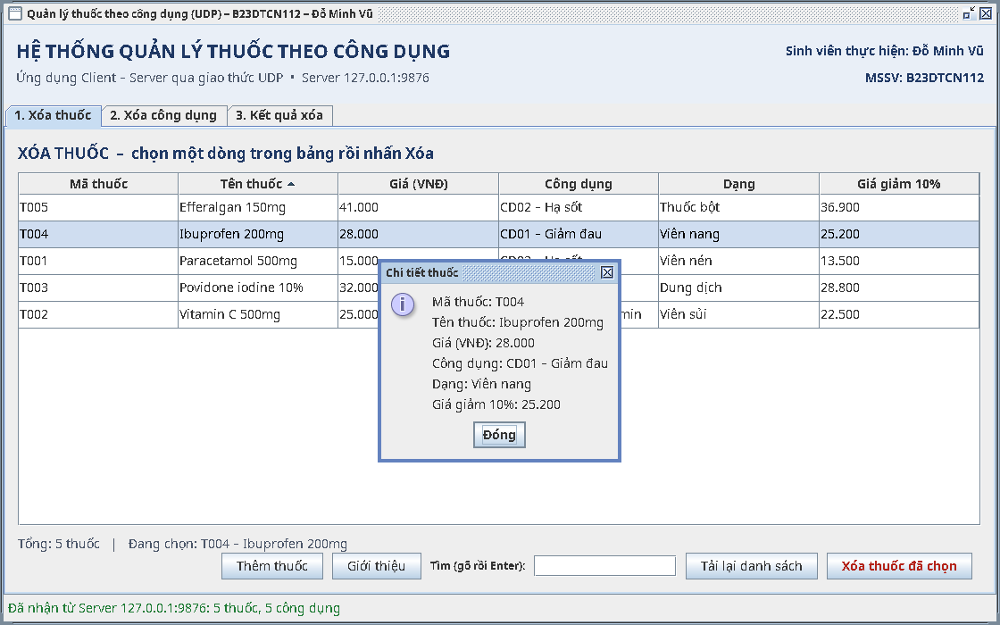
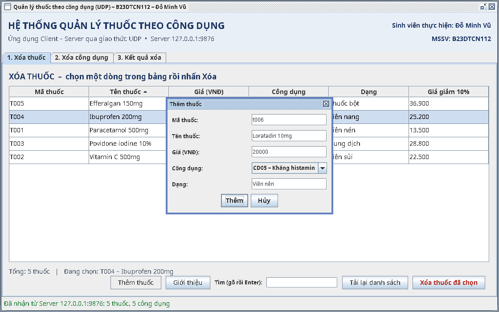
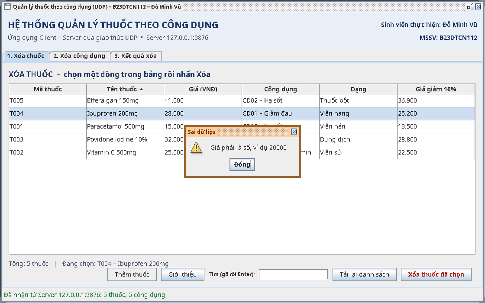
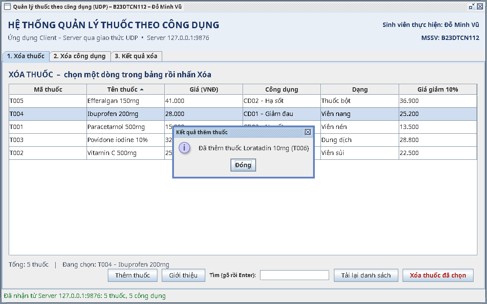
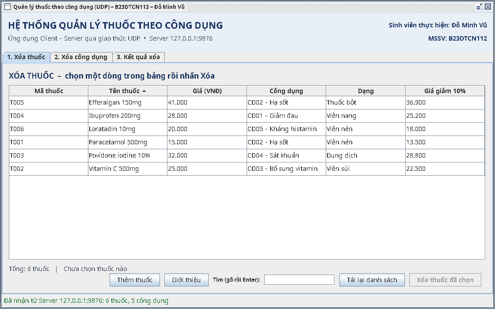

# 09 – Sổ công thức Swing: sửa giao diện theo yêu cầu của thầy

File này dành cho người **chưa từng viết Java**. Không cần hiểu hết code. Cách dùng giống nấu ăn theo sổ: thầy nói một câu → tìm món tương ứng → dán đúng chỗ → chạy lại.

**Mọi món dưới đây đã được dán thử vào bản copy của bài, biên dịch và chạy thật.** Ảnh trong file là ảnh chụp lúc chạy. Từng món làm riêng cũng chạy, làm hết các món cùng lúc cũng chạy.

---

## Phần 1 – Ba điều cần biết trước khi sửa

### 1.1. Một file giao diện có 3 khối

Mở `DeletePanel.java` ra sẽ thấy đúng 3 khối, từ trên xuống:

| Khối | Trông thế nào | Ví như |
|---|---|---|
| ① **import** ở đầu file | `import javax.swing.JButton;` | Danh sách đồ nghề mượn từ kho Java. Dùng món đồ nào thì phải có dòng import món đó |
| ② **Khai báo** ngay dưới dòng `class` | `private final JButton reloadButton = new JButton("Tải lại danh sách");` | Mua đồ về để sẵn trong nhà |
| ③ **Hàm dựng** (hàm trùng tên class: `DeletePanel(...) { ... }`) | `buttons.add(reloadButton);` | Đem đồ ra lắp vào tường |

**Gần như mọi yêu cầu sửa giao diện = thêm một dòng ở mỗi khối**, cùng lắm thêm một hàm mới ở cuối file. Quên khối ① thì IntelliJ gạch đỏ, bấm `Alt+Enter` là xong.

### 1.2. Bốn miếng Lego hay dùng nhất

| Miếng | Tạo | Hay dùng |
|---|---|---|
| Nút | `JButton nut = new JButton("Chữ trên nút");` | `nut.addActionListener(e -> việc_cần_làm);` = **bấm thì làm gì** |
| Ô nhập chữ | `JTextField o = new JTextField(12);` (12 = rộng 12 ký tự) | `o.getText()` = lấy chữ đã gõ |
| Ô chọn (sổ xuống) | `JComboBox<String> chon = new JComboBox<>(mảng_chữ);` | `chon.getSelectedIndex()` = đang chọn dòng thứ mấy (từ 0) |
| Hộp thoại | `JOptionPane.showMessageDialog(this, "Nội dung", "Tiêu đề", JOptionPane.INFORMATION_MESSAGE);` | Thay `INFORMATION_MESSAGE` bằng `WARNING_MESSAGE` (tam giác vàng) hoặc `ERROR_MESSAGE` (dấu X đỏ) |

`this` trong `showMessageDialog(this, ...)` = "hiện hộp thoại giữa cửa sổ này".

### 1.3. Phím tắt IntelliJ cứu mạng

| Phím | Làm gì | NetBeans tương đương |
|---|---|---|
| `Ctrl+F` | Tìm chữ trong file đang mở. **Dùng để tìm dòng mốc** | `Ctrl+F` |
| `Ctrl+Shift+N` | Mở file theo tên (gõ `DeletePanel`) | `Alt+Shift+O` |
| `Ctrl+G` | Nhảy tới dòng số mấy | `Ctrl+G` |
| `Alt+Enter` | Đứng ở chữ gạch đỏ → IntelliJ gợi ý cách sửa, thường là **thêm import** | `Ctrl+Shift+I` (sửa import) |
| `Ctrl+Alt+L` | Tự căn lề cho đẹp sau khi dán | `Alt+Shift+F` |
| `Ctrl+Z` | Hoàn tác, dán sai thì bấm | `Ctrl+Z` |
| `Ctrl+F2` | Tắt chương trình đang chạy (nút ■ đỏ) | nút ■ đỏ |
| `Ctrl+Shift+F10` | Chạy file đang mở | `Shift+F6` |

### 1.4. Quy trình 6 bước cho mọi yêu cầu

1. **Copy thư mục `source` ra chỗ khác** để tập. Không sửa bài nộp.
2. Nghe thầy nói → tra bảng ở Phần 2 → ra món số mấy.
3. Mở đúng file, `Ctrl+F` tìm **dòng mốc** ghi trong món, dán code vào đúng chỗ.
4. Hết gạch đỏ chưa? Còn đỏ thì `Alt+Enter`, vẫn đỏ thì tra Phần 4.
5. **Tắt Server cũ (`Ctrl+F2`)**, chạy lại `MedicineServer`, rồi chạy `MedicineClient`.
6. Bấm thử đúng thứ thầy yêu cầu. Vừa làm vừa nói to: "em thêm nút ở khối khai báo, gắn vào hàng nút, bấm thì hiện hộp thoại".

> Số dòng ghi trong mỗi món là số dòng của **bài gốc**. Làm món khác trước thì số dòng sẽ lệch, cứ `Ctrl+F` tìm dòng mốc là chắc ăn nhất.

---

## Phần 2 – Thầy nói câu này → làm món nào

| Thầy nói | Món | Độ khó | Thời gian |
|---|---|---|---|
| "Đổi chữ / màu / cỡ chữ / tên tab / kích thước cửa sổ" | Xem bảng ở [05 – Bài 2](05_sua_code_khi_thi.md) | ★ | 2 phút |
| "Cho bảng bấm vào tiêu đề cột để sắp xếp" | Món 2 | ★ | 2 phút |
| "Hiện tổng số thuốc đang có" | Món 5 | ★ | 3 phút |
| "Thêm một cột ... vào bảng" | Món 3 | ★★ | 5 phút |
| "Thêm một nút ..., bấm vào thì hiện ..." | Món 0 + Món 1 | ★★ | 5 phút |
| "Nhấp đúp vào dòng thì hiện chi tiết" | Món 6 | ★★ | 7 phút |
| "Thêm ô tìm kiếm thuốc theo tên" | Món 4 | ★★ | 7 phút |
| "Thêm chức năng thêm thuốc, có form nhập, kiểm tra dữ liệu" | Món 0 + Món 7 | ★★★ | 15 phút |
| "Thêm chức năng mới gửi lên Server" (tìm, xóa dây chuyền...) | Khuôn 3 bước ở [05](05_sua_code_khi_thi.md) | ★★★ | 10–15 phút |

---

## Phần 3 – Các món

### Món 0 – Mở hàng nút (làm một lần, các món có nút đều cần)

**Vì sao cần:** trong bài gốc, hàng nút (`buttons`) chỉ nằm trong hàm dựng của `DeletePanel`, bên ngoài không gắn thêm nút vào được. Món này đưa hàng nút lên khối khai báo, thêm hàm `addAction("chữ", việc)` để gắn nút từ chỗ khác, và đưa dòng chữ "Đang chọn..." lên trên để hàng nút dài ra không bị đè.

**1. `DeletePanel.java`**, `Ctrl+F` tìm dòng mốc (bài gốc ở dòng 22):
```java
private final JLabel selection = new JLabel(" ");
```
rồi dán **ngay dưới** dòng đó:
```java
    private final JPanel buttons = new JPanel(new FlowLayout(FlowLayout.RIGHT, Ui.GAP, 0));
```

**2. `DeletePanel.java`**, `Ctrl+F` tìm dòng mốc (bài gốc ở dòng 54):
```java
JPanel buttons = new JPanel(new FlowLayout(FlowLayout.RIGHT, Ui.GAP, 0));
```
rồi **xóa** dòng đó.

**3. `DeletePanel.java`**, `Ctrl+F` tìm dòng mốc (bài gốc ở dòng 58):
```java
footer.add(selection, BorderLayout.WEST);
```
rồi **thay cả dòng đó** bằng:
```java
        footer.add(selection, BorderLayout.NORTH);
```

**4. `DeletePanel.java`**, `Ctrl+F` tìm dòng mốc (bài gốc ở dòng 64):
```java
void setRows(List<Object[]> rows) {
```
rồi dán **ngay trên** dòng đó:
```java
    void addAction(String text, Runnable action) {
        JButton button = new JButton(text);
        button.setFont(Ui.BODY);
        button.addActionListener(e -> action.run());
        buttons.add(button, 0);
    }
```

**Chạy lên thấy:** chưa có gì khác. Món này chỉ dọn chỗ cho các món sau.

**Nếu đã làm [05 – Bài 5](05_sua_code_khi_thi.md)** thì bước 1, 2, 4 đã làm rồi, chỉ cần làm bước 3.

---

### Món 1 – Thêm một nút, bấm thì hiện hộp thoại

**Thầy nói:** "Thêm nút Giới thiệu, bấm vào thì hiện tên và mã sinh viên."

**Ý tưởng:** gọi `addAction` của Món 0, việc cần làm là hiện một hộp thoại.

**1. `MedicineClient.java`**, `Ctrl+F` tìm dòng mốc (bài gốc ở dòng 55):
```java
tabs.setFont(Ui.BODY_BOLD);
```
rồi dán **ngay trên** dòng đó:
```java
        medicinePanel.addAction("Giới thiệu", () -> JOptionPane.showMessageDialog(this,
                "Sinh viên: " + Ui.STUDENT_NAME + "\nMSSV: " + Ui.STUDENT_ID, "Giới thiệu", JOptionPane.INFORMATION_MESSAGE));
```

Đọc là: tab thuốc (`medicinePanel`) thêm nút "Giới thiệu". Bấm thì hiện hộp thoại có tên và MSSV, `\n` là xuống dòng.

**Đổi sang việc khác:** chỉ thay phần sau `() ->`. Ví dụ muốn bấm là tải lại danh sách: `medicinePanel.addAction("Làm mới", this::reload);`. Muốn nút nằm ở tab công dụng: đổi `medicinePanel` thành `usagePanel`.



---

### Món 2 – Bấm tiêu đề cột để sắp xếp (1 dòng)

**Thầy nói:** "Cho bảng sắp xếp được theo tên."

**1. `Ui.java`**, `Ctrl+F` tìm dòng mốc (bài gốc ở dòng 57):
```java
table.getTableHeader().setReorderingAllowed(false);
```
rồi dán **ngay dưới** dòng đó:
```java
        table.setAutoCreateRowSorter(true);
```

Hàm `styleTable` dùng cho **mọi bảng**, nên cả 3 tab đều sắp xếp được. Bấm tiêu đề "Tên thuốc" một lần là xếp A→Z (có mũi tên ▲), bấm lần nữa là Z→A.

**Câu thầy có thể hỏi:** "Sắp xếp rồi bấm Xóa có xóa nhầm dòng không?" → Không. Hàm `cell` trong `DeletePanel` đã dùng `convertRowIndexToModel`, tức là đổi "dòng thứ mấy trên màn hình" thành "dòng thứ mấy trong dữ liệu".



---

### Món 3 – Thêm một cột vào bảng

**Thầy nói:** "Thêm cột giá sau khi giảm 10%."

**Ý tưởng:** bảng có hai thứ phải khớp nhau: **danh sách tên cột** và **mỗi dòng dữ liệu**. Thêm cột thì thêm ở cả hai chỗ, cùng vị trí (ở đây là cuối).

**1. `MedicineClient.java`**, `Ctrl+F` tìm dòng mốc (bài gốc ở dòng 50):
```java
new String[] {"Mã thuốc", "Tên thuốc", "Giá (VNĐ)", "Công dụng", "Dạng"},
```
rồi **thay cả dòng đó** bằng:
```java
                new String[] {"Mã thuốc", "Tên thuốc", "Giá (VNĐ)", "Công dụng", "Dạng", "Giá giảm 10%"},
```

**2. `MedicineClient.java`**, `Ctrl+F` tìm dòng mốc (bài gốc ở dòng 111):
```java
.map(m -> new Object[] {m.id(), m.name(), Ui.MONEY.format(m.price()), usageLabel(m, usageById), m.form()})
```
rồi **thay cả dòng đó** bằng:
```java
                .map(m -> new Object[] {m.id(), m.name(), Ui.MONEY.format(m.price()), usageLabel(m, usageById), m.form(),
                        Ui.MONEY.format(m.price() * 90 / 100)})
```

- `m.price() * 90 / 100` = giá × 90%. Nhân trước rồi mới chia, để không mất phần lẻ.
- `Ui.MONEY.format(...)` = in số có dấu chấm ngăn cách: `13500` → `13.500`.

**Thêm cột khác:** chỉ đổi tên cột và công thức. Ví dụ cột "Tên viết hoa": tên cột `"Tên viết hoa"`, dữ liệu `m.name().toUpperCase()`.

**Lỗi hay gặp:** thêm tên cột mà quên thêm dữ liệu → cột trống. Thêm dữ liệu mà quên tên cột → dữ liệu không hiện.



---

### Món 4 – Ô tìm kiếm theo tên

**Thầy nói:** "Thêm ô tìm kiếm, gõ tên thuốc thì bảng chỉ hiện thuốc đó."

**Ý tưởng:** không cần gửi gì lên Server. Bảng đã có đủ dữ liệu, chỉ cần **lọc** cái đang hiện. Java có sẵn bộ lọc: `TableRowSorter` (bộ sắp xếp và lọc dòng) cùng `RowFilter` (điều kiện lọc).

**1. `DeletePanel.java`, phần import ở đầu file**: thêm các dòng sau (hoặc dán code xong, bấm `Alt+Enter` ở chữ gạch đỏ để IntelliJ tự thêm):
```java
import java.util.regex.Pattern;
import javax.swing.JTextField;
import javax.swing.RowFilter;
import javax.swing.table.TableRowSorter;
```

**2. `DeletePanel.java`**, `Ctrl+F` tìm dòng mốc (bài gốc ở dòng 36):
```java
Ui.styleTable(table);
```
rồi dán **ngay dưới** dòng đó:
```java
        TableRowSorter<DefaultTableModel> sorter = new TableRowSorter<>(model);
        table.setRowSorter(sorter);
```

**3. `DeletePanel.java`**, `Ctrl+F` tìm dòng mốc (bài gốc ở dòng 56):
```java
buttons.add(deleteButton);
```
rồi dán **ngay dưới** dòng đó:
```java
        JTextField search = new JTextField(12);
        search.setFont(Ui.BODY);
        search.addActionListener(e -> {
            sorter.setRowFilter(RowFilter.regexFilter("(?iu)" + Pattern.quote(search.getText())));
            updateSelection();
        });
        buttons.add(new JLabel("Tìm (gõ rồi Enter):"), 0);
        buttons.add(search, 1);
```

Đọc từng dòng:
- `new TableRowSorter<>(model)` + `setRowSorter` = gắn bộ lọc vào bảng.
- `new JTextField(12)` = ô nhập rộng 12 ký tự.
- `addActionListener` của ô nhập = việc làm khi **bấm Enter** trong ô.
- `RowFilter.regexFilter("(?iu)" + Pattern.quote(chữ))` = giữ lại dòng có chứa chữ đã gõ. `(?iu)` = không phân biệt hoa thường, kể cả chữ có dấu. `Pattern.quote` = coi chữ gõ vào là chữ thường, kể cả khi có ký tự lạ như `%` hay `(`.
- `updateSelection()` = cập nhật dòng chữ phía dưới (nếu đã làm Món 5 thì "Tổng" sẽ đếm lại).
- `buttons.add(..., 0)` = gắn vào **đầu** hàng nút.

**Cách dùng:** gõ `vitamin` rồi Enter → chỉ còn Vitamin C. Xóa trắng ô rồi Enter → hiện lại tất cả.



---

### Món 5 – Hiện tổng số dòng

**Thầy nói:** "Hiện tổng số thuốc đang có ở dưới bảng."

**Ý tưởng:** đã có sẵn dòng chữ "Đang chọn: ...", được cập nhật mỗi khi bảng đổi (hàm `updateSelection`). Chỉ cần ghép thêm "Tổng: n" vào đầu.

**1. `DeletePanel.java`**, `Ctrl+F` tìm dòng mốc (bài gốc ở dòng 79):
```java
selection.setText(row < 0 ? "Chưa chọn " + objectName + " nào" : "Đang chọn: " + cell(row, 0) + " – " + cell(row, 1));
```
rồi **thay cả dòng đó** bằng:
```java
        selection.setText("Tổng: " + table.getRowCount() + " " + objectName + "   |   "
                + (row < 0 ? "Chưa chọn " + objectName + " nào" : "Đang chọn: " + cell(row, 0) + " – " + cell(row, 1)));
```

`table.getRowCount()` = số dòng đang hiện trên bảng. Dòng này chạy lại sau mỗi lần tải lại, xóa, chọn dòng và tìm kiếm, nên con số luôn đúng.

Kết quả: dưới bảng ghi `Tổng: 5 thuốc | Chưa chọn thuốc nào`. Xem góc trái dưới của ảnh Món 3 và Món 4.

---

### Món 6 – Nhấp đúp vào dòng thì hiện chi tiết

**Thầy nói:** "Nhấp đúp vào một thuốc thì hiện đầy đủ thông tin."

**Ý tưởng:** gắn "tai nghe chuột" (`MouseAdapter`) vào bảng. Khi nghe thấy bấm 2 lần (`getClickCount() == 2`) thì gom chữ của mọi cột trong dòng đó thành một đoạn rồi hiện hộp thoại.

**1. `DeletePanel.java`, phần import ở đầu file**: thêm các dòng sau (hoặc dán code xong, bấm `Alt+Enter` ở chữ gạch đỏ để IntelliJ tự thêm):
```java
import java.awt.event.MouseAdapter;
import java.awt.event.MouseEvent;
```

**2. `DeletePanel.java`**, `Ctrl+F` tìm dòng mốc (bài gốc ở dòng 37):
```java
table.getSelectionModel().addListSelectionListener(e -> updateSelection());
```
rồi dán **ngay dưới** dòng đó:
```java
        table.addMouseListener(new MouseAdapter() {
            @Override
            public void mouseClicked(MouseEvent e) {
                int row = table.getSelectedRow();
                if (e.getClickCount() == 2 && row >= 0) {
                    showDetails(row);
                }
            }
        });
```

**3. `DeletePanel.java`**, `Ctrl+F` tìm dòng mốc (bài gốc ở dòng 98):
```java
private String cell(int viewRow, int column) {
```
rồi dán **ngay trên** dòng đó:
```java
    private void showDetails(int row) {
        StringBuilder text = new StringBuilder();
        for (int column = 0; column < model.getColumnCount(); column++) {
            text.append(model.getColumnName(column)).append(": ").append(cell(row, column)).append("\n");
        }
        JOptionPane.showMessageDialog(this, text.toString(), "Chi tiết " + objectName, JOptionPane.INFORMATION_MESSAGE);
    }
```

- `new MouseAdapter() { ... }` = tạo nhanh một "tai nghe chuột", chỉ viết lại phần mình cần là `mouseClicked` (khi bấm chuột).
- Vòng `for` chạy qua từng cột: `getColumnName` = tên cột, `cell(row, column)` = chữ trong ô. Ghép thành "Tên cột: giá trị" và xuống dòng.
- Hàm `showDetails` dùng chung cho cả tab thuốc lẫn tab công dụng, vì `DeletePanel` dùng cho cả hai.



---

### Món 7 – Form thêm thuốc: nhiều ô nhập, ô chọn công dụng, kiểm tra dữ liệu

**Thầy nói:** "Thêm chức năng thêm thuốc. Có form nhập, nhập sai thì báo lỗi."

Đây là món khó nhất, gồm 3 phần: Server biết lệnh `ADD_MED`, Client có nút, và form kiểm tra dữ liệu trước khi gửi.

**Phần Server** (giống hệt [05 – Bài 5](05_sua_code_khi_thi.md), đã làm rồi thì bỏ qua):

**1. `Protocol.java`**, `Ctrl+F` tìm dòng mốc (bài gốc ở dòng 16):
```java
public static final String DELETE_USAGE = "DEL_USE";
```
rồi dán **ngay dưới** dòng đó:
```java
    public static final String ADD_MEDICINE = "ADD_MED";
```

**2. `MedicineServer.java`**, `Ctrl+F` tìm dòng mốc (bài gốc ở dòng 53):
```java
default -> Response.error("Lệnh không hợp lệ: " + parts[0]);
```
rồi dán **ngay trên** dòng đó:
```java
            case Protocol.ADD_MEDICINE -> addMedicine(parts.length > 1 ? parts[1] : "");
```

**3. `MedicineServer.java`**, `Ctrl+F` tìm dòng mốc (bài gốc ở dòng 89):
```java
private static <T> String rows(Collection<T> items, Function<T, String> toRow) {
```
rồi dán **ngay trên** dòng đó:
```java
    private Response addMedicine(String row) {
        String[] f = row.split("\\|", -1);
        if (f.length != 5) {
            return Response.error("Dữ liệu thuốc phải có 5 trường");
        }
        Medicine medicine;
        try {
            medicine = Medicine.fromRow(f);
        } catch (NumberFormatException e) {
            return Response.error("Giá thuốc phải là số");
        }
        if (medicines.containsKey(medicine.id())) {
            return Response.error("Mã thuốc " + medicine.id() + " đã tồn tại");
        }
        if (!usages.containsKey(medicine.usageId())) {
            return Response.error("Không có công dụng mã " + medicine.usageId());
        }
        medicines.put(medicine.id(), medicine);
        return Response.success("Đã thêm thuốc " + medicine.name() + " (" + medicine.id() + ")");
    }
```

**Phần Client** (cần Món 0):

**1. `MedicineClient.java`, phần import ở đầu file**: thêm các dòng sau (hoặc dán code xong, bấm `Alt+Enter` ở chữ gạch đỏ để IntelliJ tự thêm):
```java
import javax.swing.JComboBox;
import javax.swing.JTextField;
```

**2. `MedicineClient.java`**, `Ctrl+F` tìm dòng mốc (bài gốc ở dòng 39):
```java
private final JLabel status = new JLabel();
```
rồi dán **ngay dưới** dòng đó:
```java
    private List<Usage> usages = List.of();
```

**3. `MedicineClient.java`**, `Ctrl+F` tìm dòng mốc (bài gốc ở dòng 105):
```java
private void showCatalog(Catalog catalog) {
```
rồi dán **ngay dưới** dòng đó:
```java
        usages = catalog.usages();
```

**4. `MedicineClient.java`**, `Ctrl+F` tìm dòng mốc (bài gốc ở dòng 55):
```java
tabs.setFont(Ui.BODY_BOLD);
```
rồi dán **ngay trên** dòng đó:
```java
        medicinePanel.addAction("Thêm thuốc", this::openAddForm);
```

**5. `MedicineClient.java`**, `Ctrl+F` tìm dòng mốc (bài gốc ở dòng 145):
```java
private void showDeleteResult(String objectName, String id, Response response, boolean fromServer) {
```
rồi dán **ngay trên** dòng đó:
```java
    private void openAddForm() {
        JTextField id = new JTextField();
        JTextField name = new JTextField();
        JTextField price = new JTextField();
        JComboBox<String> usage = new JComboBox<>(usages.stream().map(u -> u.id() + " – " + u.name()).toArray(String[]::new));
        JTextField form = new JTextField("Viên nén");
        JPanel panel = new JPanel(new GridLayout(0, 2, Ui.GAP, Ui.GAP));
        panel.add(new JLabel("Mã thuốc:"));
        panel.add(id);
        panel.add(new JLabel("Tên thuốc:"));
        panel.add(name);
        panel.add(new JLabel("Giá (VNĐ):"));
        panel.add(price);
        panel.add(new JLabel("Công dụng:"));
        panel.add(usage);
        panel.add(new JLabel("Dạng:"));
        panel.add(form);

        Object[] options = {"Thêm", "Hủy"};
        int choice = JOptionPane.showOptionDialog(this, panel, "Thêm thuốc", JOptionPane.DEFAULT_OPTION,
                JOptionPane.PLAIN_MESSAGE, null, options, options[0]);
        if (choice != 0) {
            return;
        }
        if (id.getText().isBlank() || name.getText().isBlank() || usage.getSelectedIndex() < 0) {
            JOptionPane.showMessageDialog(this, "Mã thuốc, tên thuốc và công dụng không được để trống", "Thiếu dữ liệu",
                    JOptionPane.WARNING_MESSAGE);
            return;
        }
        long value;
        try {
            value = Long.parseLong(price.getText().trim());
        } catch (NumberFormatException e) {
            JOptionPane.showMessageDialog(this, "Giá phải là số, ví dụ 20000", "Sai dữ liệu", JOptionPane.WARNING_MESSAGE);
            return;
        }
        String usageId = usages.get(usage.getSelectedIndex()).id();
        String row = Response.joinRow(id.getText().trim().toUpperCase(), name.getText().trim(), value, usageId,
                form.getText().trim());
        runInBackground(() -> client.send(Protocol.ADD_MEDICINE, row), response -> {
            JOptionPane.showMessageDialog(this, response.body(), "Kết quả thêm thuốc",
                    response.ok() ? JOptionPane.INFORMATION_MESSAGE : JOptionPane.ERROR_MESSAGE);
            reload();
        }, error -> JOptionPane.showMessageDialog(this, "Lỗi kết nối: " + reason(error), "Lỗi kết nối",
                JOptionPane.ERROR_MESSAGE));
    }
```

Đọc hàm `openAddForm` theo 4 đoạn:
1. **Tạo ô:** 4 ô nhập (`JTextField`) và 1 ô chọn công dụng (`JComboBox`). Ô chọn lấy danh sách công dụng mới nhất từ Server, vì `usages` được cập nhật mỗi lần tải lại.
2. **Xếp ô:** `GridLayout(0, 2, ...)` = lưới 2 cột, số hàng tùy ý: cột trái là nhãn, cột phải là ô. Thêm một ô mới = thêm 2 dòng `panel.add`.
3. **Hiện form:** `showOptionDialog` với hai nút tự đặt chữ `{"Thêm", "Hủy"}`. Bấm "Thêm" thì được `0`.
4. **Kiểm tra rồi gửi:**
   - `isBlank()` = để trống (hoặc toàn dấu cách) → báo "không được để trống" và dừng (`return`).
   - `Long.parseLong` đổi chữ thành số. Gõ `abc` thì Java hú còi `NumberFormatException`, `catch` bắt còi và báo "Giá phải là số".
   - Hợp lệ hết thì `Response.joinRow` ghép thành `T006|Loratadin 10mg|20000|CD05|Viên nén` rồi gửi bằng `runInBackground`, giống hệt cách hàm `delete` gửi. Server trả lời xong thì hiện kết quả và tải lại bảng.

**Kiểm tra 2 lớp:** Client kiểm tra trống/không phải số để báo lỗi ngay, khỏi gửi đi. Server **vẫn kiểm tra lại** (trùng mã, công dụng không có), vì Server không được tin Client. Thầy rất hay hỏi câu này.

| Form điền đúng | Giá gõ `abc` | Thêm thành công | Bảng có T006 |
|---|---|---|---|
|  |  |  |  |

Server ghi log lúc chạy thật:
```
ADD_MED T006|Loratadin 10mg|20000|CD05|Viên nén  ->  OK  Đã thêm thuốc Loratadin 10mg (T006)
```
Gõ mã `t006` chữ thường thì vẫn thành `T006`, nhờ `toUpperCase()`.

**Biến thể thầy có thể ra:** "Thêm công dụng" làm y hệt: 3 ô (mã, tên, mô tả), lệnh `ADD_USE` ở Server, `usages.put(...)`.

---

## Phần 4 – Gạch đỏ / lỗi khi chạy → sửa thế nào

| Thấy gì | Nghĩa | Sửa |
|---|---|---|
| Chữ `JTextField`, `JComboBox`, `Pattern`... gạch đỏ, báo `cannot find symbol ... class` | Thiếu import (khối ①) | Đứng ở chữ đỏ, `Alt+Enter` → Import class |
| `cannot find symbol: method addAction` | Chưa làm Món 0 | Làm Món 0 |
| `cannot find symbol: variable buttons` | Dán code dùng `buttons` vào chỗ **trước** dòng tạo `buttons` | Dán lại đúng dưới dòng mốc |
| `variable buttons is already defined` | Món 0 quên xóa dòng `JPanel buttons = ...` trong hàm dựng | Xóa dòng đó |
| `variable search is already defined` | Dán một món hai lần | `Ctrl+Z` hoặc xóa bản dán thừa |
| `';' expected`, `reached end of file while parsing` | Dán thiếu `;` hoặc thiếu `}` | Dán lại cả khối, rồi `Ctrl+Alt+L` để xem ngoặc có thẳng hàng không |
| `local variables referenced from a lambda expression must be final` | Gán lại một biến đã dùng trong `e -> ...` | Đặt tên biến mới thay vì gán lại |
| Chạy lên nhưng không thấy nút mới | Chưa chạy lại Client, hoặc gắn nút vào tab khác | Tắt Client, chạy lại, xem đủ cả 3 tab |
| Hộp thoại báo `Lệnh không hợp lệ: ADD_MED` | **Server đang chạy là bản cũ** | `Ctrl+F2` tắt Server, chạy lại |
| `BindException: Address already in use` | Có hai Server cùng chạy | Tắt hết Server, chỉ chạy một |

---

## Phần 5 – Luyện

1. Copy thư mục `source` ra `Desktop/tap_swing`, mở bằng IntelliJ.
2. Làm lần lượt Món 0 → 7, mỗi món xong thì chạy và so với ảnh.
3. Xóa bản copy, copy lại bản sạch, rồi làm **đề thi thử** ở [10 – Đề thi thử](10_de_thi_thu.md). Lần đầu được nhìn sổ, lần hai không nhìn.

Làm được Món 1, 3, 4, 5 mà không nhìn sổ là đủ sức xử lý phần lớn yêu cầu sửa giao diện khi vấn đáp.
