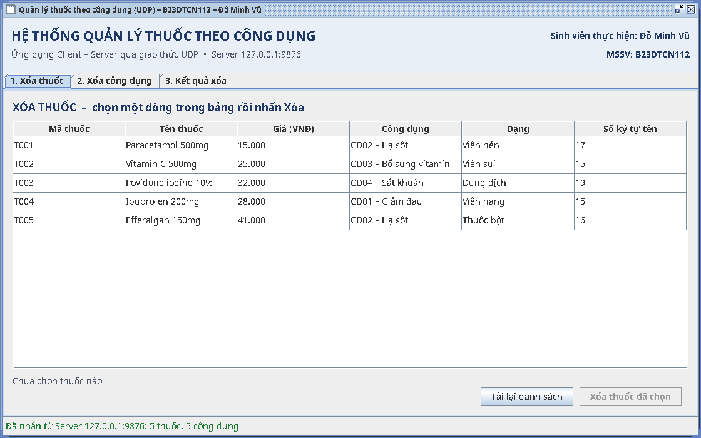
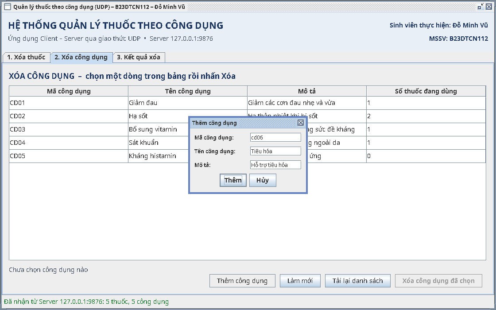
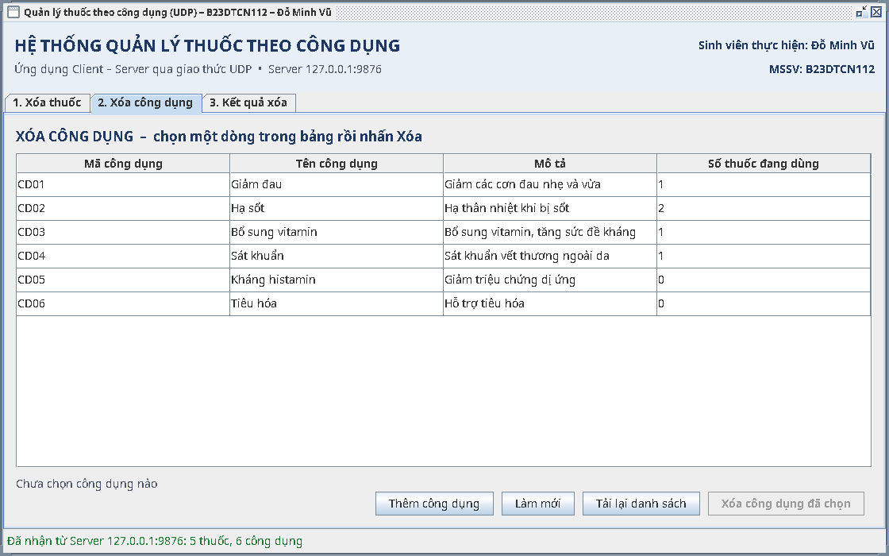

# 10 – Đề thi thử: sửa code theo yêu cầu

10 đề giống kiểu thầy hay ra khi vấn đáp, xếp từ dễ đến khó. **Đáp án của mọi đề đã được chạy thử thật trên bản copy.**

**Cách luyện:**
1. Copy bản sạch thư mục `source` ra `Desktop/thi_thu`. Mỗi lượt luyện dùng một bản sạch mới.
2. Bật đồng hồ, làm từng đề trong thời gian ghi ở bảng.
3. **Lần 1** được mở [09 – Sổ công thức](09_so_cong_thuc_swing.md) và [05 – Sửa code khi thi](05_sua_code_khi_thi.md). **Lần 2** (hôm sau) không mở gì, chỉ mở đáp án khi bí quá 5 phút.
4. Làm xong mỗi đề: **tắt Server, chạy lại Server, chạy lại Client**, bấm thử đúng yêu cầu.
5. Trong lúc gõ, **nói to** mình đang sửa khối nào, file nào. Khi thi, thầy chấm cả phần nói.

| Đề | Thầy nói | Độ khó | Thời gian | Dùng |
|---|---|---|---|---|
| 1 | "Em đổi tiêu đề lớn thành 'QUẢN LÝ THUỐC – B23DTCN112' và cho chữ trong bảng to hơn." | ★ | 3 phút | 05 – Bài 2 |
| 2 | "Cho bảng bấm tiêu đề cột để sắp xếp." | ★ | 3 phút | 09 – Món 2 |
| 3 | "Ở tab công dụng, thêm nút 'Làm mới' để tải lại danh sách." | ★★ | 5 phút | 09 – Món 0, 1 (biến thể) |
| 4 | "Bảng thuốc thêm cột 'Số ký tự tên'." | ★★ | 5 phút | 09 – Món 3 (biến thể) |
| 5 | "Dưới bảng hiện tổng số thuốc." | ★ | 3 phút | 09 – Món 5 |
| 6 | "Thêm ô tìm kiếm. Ở tab công dụng gõ 'sốt' thì chỉ còn công dụng Hạ sốt." | ★★ | 7 phút | 09 – Món 4 |
| 7 | "Nhấp đúp vào một công dụng thì hiện đầy đủ thông tin." | ★★ | 7 phút | 09 – Món 6 |
| 8 | "Thêm chức năng thêm thuốc, có form, giá nhập chữ thì báo lỗi." | ★★★ | 15 phút | 09 – Món 7 |
| 9 | "Thêm chức năng thêm công dụng." | ★★★ | 15 phút | 09 – Món 7 (biến thể) |
| 10 | "Xóa công dụng thì xóa luôn các thuốc đang dùng nó." | ★★★ | 10 phút | 05 – Bài 4 |

Làm được đề 1–7 trong khoảng 40 phút, không nhìn sổ, là đạt. Đề 8–10 được nhìn sổ cũng không sao: khi thi thầy thường chỉ yêu cầu một chức năng, và nói đúng các bước quan trọng hơn gõ nhanh.

---

## Đáp án

<details><summary><b>Đề 1</b> – đổi tiêu đề, chữ to hơn</summary>

- `MedicineClient.java`, hàm `header()`: đổi chữ trong `label("HỆ THỐNG QUẢN LÝ THUỐC THEO CÔNG DỤNG", ...)` thành `"QUẢN LÝ THUỐC – B23DTCN112"`.
- `Ui.java`: `BODY = new Font(Font.SANS_SERIF, Font.PLAIN, 14)` → đổi `14` thành `16`. Nên tăng thêm `ROW_HEIGHT = 30` lên `34` để chữ to không bị cắt.

**Nói khi làm:** "Màu, font, kích thước được gom trong `Ui.java`, nên đổi một chỗ là cả chương trình đổi theo."
</details>

<details><summary><b>Đề 2</b> – sắp xếp</summary>

Đúng Món 2 trong sổ: thêm `table.setAutoCreateRowSorter(true);` vào `Ui.styleTable`.

**Thầy hỏi tiếp:** "Sắp xếp rồi xóa có nhầm dòng không?" → Không, vì `cell()` dùng `convertRowIndexToModel`.
</details>

<details><summary><b>Đề 3</b> – nút Làm mới ở tab công dụng</summary>

Làm Món 0 trước, rồi trong `MedicineClient.java`:

**1. `MedicineClient.java`**, `Ctrl+F` tìm dòng mốc (bài gốc ở dòng 55):
```java
tabs.setFont(Ui.BODY_BOLD);
```
rồi dán **ngay trên** dòng đó:
```java
        usagePanel.addAction("Làm mới", this::reload);
```

Khác Món 1 ở hai chỗ: `usagePanel` (tab công dụng) thay cho `medicinePanel`, và việc cần làm là `this::reload` (hàm tải lại có sẵn) thay cho hộp thoại. Kết quả: nút "Làm mới" nằm ở tab 2, xem ảnh đề 9.
</details>

<details><summary><b>Đề 4</b> – cột Số ký tự tên</summary>

Giống Món 3, chỉ đổi tên cột và công thức:

**1. `MedicineClient.java`**, `Ctrl+F` tìm dòng mốc (bài gốc ở dòng 50):
```java
new String[] {"Mã thuốc", "Tên thuốc", "Giá (VNĐ)", "Công dụng", "Dạng"},
```
rồi **thay cả dòng đó** bằng:
```java
                new String[] {"Mã thuốc", "Tên thuốc", "Giá (VNĐ)", "Công dụng", "Dạng", "Số ký tự tên"},
```

**2. `MedicineClient.java`**, `Ctrl+F` tìm dòng mốc (bài gốc ở dòng 111):
```java
.map(m -> new Object[] {m.id(), m.name(), Ui.MONEY.format(m.price()), usageLabel(m, usageById), m.form()})
```
rồi **thay cả dòng đó** bằng:
```java
                .map(m -> new Object[] {m.id(), m.name(), Ui.MONEY.format(m.price()), usageLabel(m, usageById), m.form(),
                        m.name().length()})
```

`m.name().length()` = số ký tự của tên. "Paracetamol 500mg" ra 17.


</details>

<details><summary><b>Đề 5, 6, 7</b></summary>

Làm đúng Món 5, Món 4, Món 6 trong sổ. `DeletePanel` dùng chung cho cả tab thuốc lẫn tab công dụng, nên sửa một lần là **cả hai tab** đều có ô tìm kiếm, tổng số và nhấp đúp.

**Nói khi làm:** "Em sửa trong `DeletePanel` vì cả hai tab đều dùng lại nó, không phải sửa hai lần."
</details>

<details><summary><b>Đề 8</b> – thêm thuốc</summary>

Đúng Món 7 trong sổ (cả phần Server lẫn Client).
</details>

<details><summary><b>Đề 9</b> – thêm công dụng</summary>

Giống Món 7, nhưng 3 ô (mã, tên, mô tả), không có ô chọn, không có giá. Làm Món 0 trước. Theo khuôn 3 bước: ① `Protocol` → ② `MedicineServer` → ③ `MedicineClient`.

**1. `Protocol.java`**, `Ctrl+F` tìm dòng mốc (bài gốc ở dòng 16):
```java
public static final String DELETE_USAGE = "DEL_USE";
```
rồi dán **ngay dưới** dòng đó:
```java
    public static final String ADD_USAGE = "ADD_USE";
```

**2. `MedicineServer.java`**, `Ctrl+F` tìm dòng mốc (bài gốc ở dòng 53):
```java
default -> Response.error("Lệnh không hợp lệ: " + parts[0]);
```
rồi dán **ngay trên** dòng đó:
```java
            case Protocol.ADD_USAGE -> addUsage(parts.length > 1 ? parts[1] : "");
```

**3. `MedicineServer.java`**, `Ctrl+F` tìm dòng mốc (bài gốc ở dòng 89):
```java
private static <T> String rows(Collection<T> items, Function<T, String> toRow) {
```
rồi dán **ngay trên** dòng đó:
```java
    private Response addUsage(String row) {
        String[] f = row.split("\\|", -1);
        if (f.length != 3 || f[0].isBlank() || f[1].isBlank()) {
            return Response.error("Cần đủ mã, tên và mô tả công dụng");
        }
        Usage usage = Usage.fromRow(f);
        if (usages.containsKey(usage.id())) {
            return Response.error("Mã công dụng " + usage.id() + " đã tồn tại");
        }
        usages.put(usage.id(), usage);
        return Response.success("Đã thêm công dụng " + usage.name() + " (" + usage.id() + ")");
    }
```

**4. `MedicineClient.java`, phần import ở đầu file**: thêm các dòng sau (hoặc dán code xong, bấm `Alt+Enter` ở chữ gạch đỏ để IntelliJ tự thêm):
```java
import javax.swing.JTextField;
```

**5. `MedicineClient.java`**, `Ctrl+F` tìm dòng mốc (bài gốc ở dòng 55):
```java
tabs.setFont(Ui.BODY_BOLD);
```
rồi dán **ngay trên** dòng đó:
```java
        usagePanel.addAction("Thêm công dụng", this::openAddUsageForm);
```

**6. `MedicineClient.java`**, `Ctrl+F` tìm dòng mốc (bài gốc ở dòng 145):
```java
private void showDeleteResult(String objectName, String id, Response response, boolean fromServer) {
```
rồi dán **ngay trên** dòng đó:
```java
    private void openAddUsageForm() {
        JTextField id = new JTextField();
        JTextField name = new JTextField();
        JTextField description = new JTextField();
        JPanel panel = new JPanel(new GridLayout(0, 2, Ui.GAP, Ui.GAP));
        panel.add(new JLabel("Mã công dụng:"));
        panel.add(id);
        panel.add(new JLabel("Tên công dụng:"));
        panel.add(name);
        panel.add(new JLabel("Mô tả:"));
        panel.add(description);

        Object[] options = {"Thêm", "Hủy"};
        int choice = JOptionPane.showOptionDialog(this, panel, "Thêm công dụng", JOptionPane.DEFAULT_OPTION,
                JOptionPane.PLAIN_MESSAGE, null, options, options[0]);
        if (choice != 0) {
            return;
        }
        if (id.getText().isBlank() || name.getText().isBlank()) {
            JOptionPane.showMessageDialog(this, "Mã và tên công dụng không được để trống", "Thiếu dữ liệu",
                    JOptionPane.WARNING_MESSAGE);
            return;
        }
        String row = Response.joinRow(id.getText().trim().toUpperCase(), name.getText().trim(),
                description.getText().trim());
        runInBackground(() -> client.send(Protocol.ADD_USAGE, row), response -> {
            JOptionPane.showMessageDialog(this, response.body(), "Kết quả thêm công dụng",
                    response.ok() ? JOptionPane.INFORMATION_MESSAGE : JOptionPane.ERROR_MESSAGE);
            reload();
        }, error -> JOptionPane.showMessageDialog(this, "Lỗi kết nối: " + reason(error), "Lỗi kết nối",
                JOptionPane.ERROR_MESSAGE));
    }
```

Server log lúc chạy thật:
```
ADD_USE CD06|Tiêu hóa|Hỗ trợ tiêu hóa  ->  OK  Đã thêm công dụng Tiêu hóa (CD06)
```

| Form | Bảng có CD06 |
|---|---|
|  |  |
</details>

<details><summary><b>Đề 10</b> – xóa dây chuyền</summary>

Đúng [05 – Bài 4](05_sua_code_khi_thi.md).

**Thầy hỏi tiếp:** "Làm vậy có rủi ro gì?" → Xóa nhầm là mất cả loạt thuốc, nên câu hỏi xác nhận phải nói rõ "sẽ xóa cả các thuốc đang dùng".
</details>

---

## Câu hỏi miệng hay đi kèm khi sửa code

| Thầy hỏi | Trả lời |
|---|---|
| "Sao em sửa xong phải chạy lại Server?" | Server đang chạy là bản cũ, chưa có code mới. Còn phải tắt nó trước, vì nó đang giữ cổng 9876 |
| "Kiểm tra dữ liệu ở Client rồi, sao Server còn kiểm tra?" | Client chỉ kiểm tra để báo lỗi nhanh. Server mới giữ dữ liệu thật, và ai cũng có thể gửi gói UDP tới Server mà không qua giao diện này |
| "Ô tìm kiếm có gửi gì lên Server không?" | Không. Bảng đã có đủ dữ liệu, chỉ lọc phần đang hiện |
| "Sao gửi UDP phải dùng `runInBackground`?" | Chờ Server tối đa 5 giây. Chờ trên luồng giao diện thì cửa sổ đơ cứng |
| "Thêm nút mới thì sửa những đâu?" | Tạo nút, gắn việc khi bấm (`addActionListener`), rồi gắn nút vào hàng nút |
